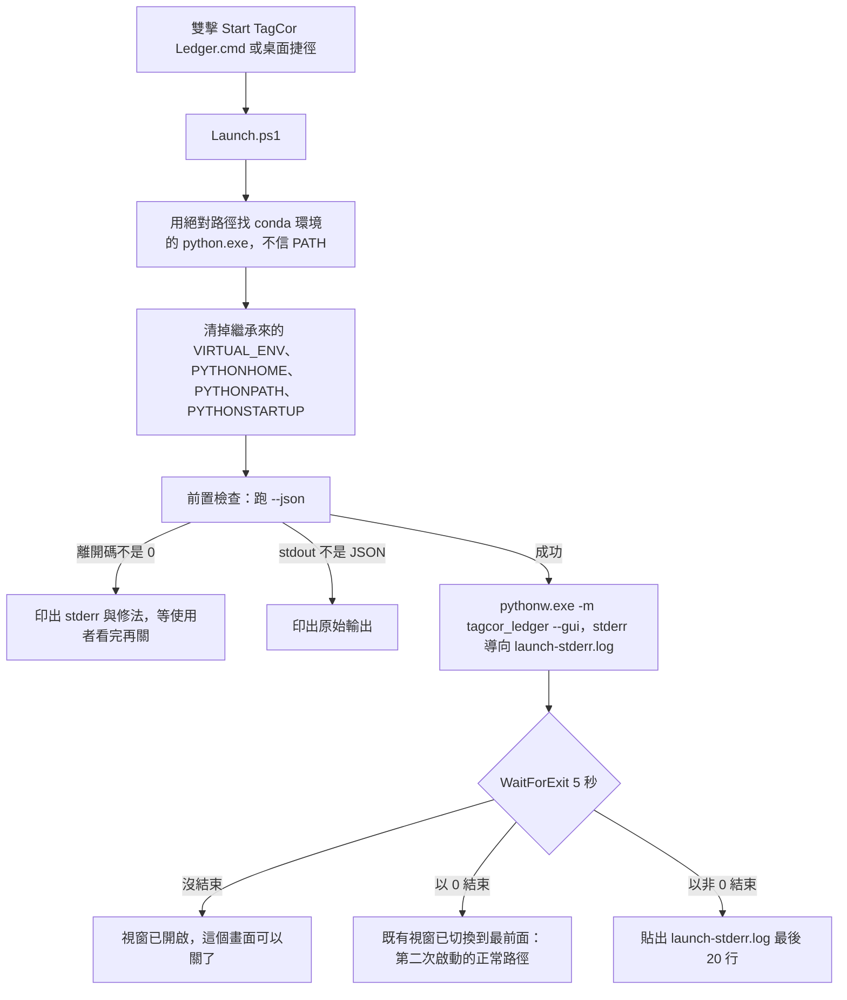
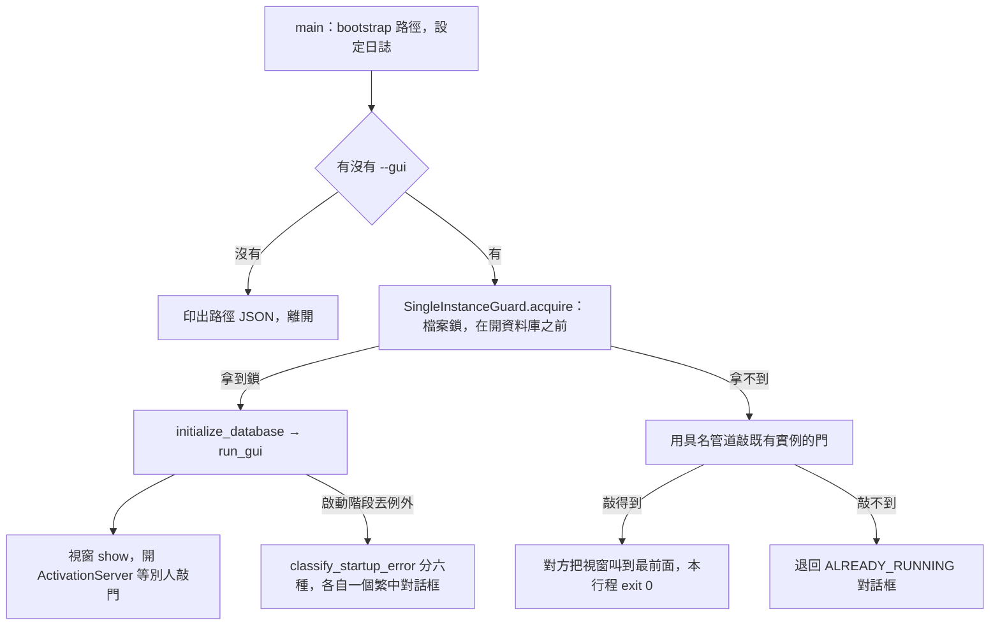
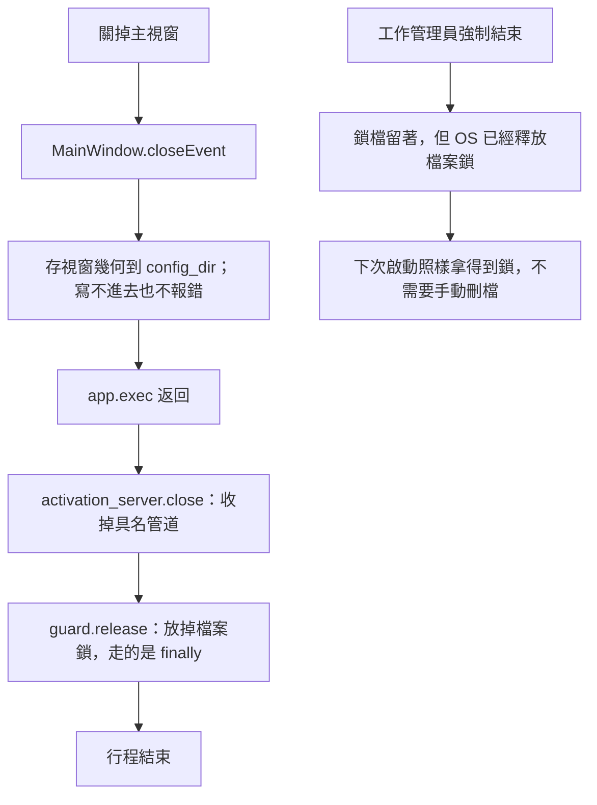

# 應用程式生命週期 —— 啟動、單一實例、關閉

**這一份是「程式怎麼開起來、怎麼結束」的權威。**
資料表見 [資料模型](data-model.md)，資料的狀態轉移見 [狀態機](state-machines.md) ——
**這裡寫的不是資料庫裡的狀態，是行程的生命週期。**

> 「應用程式啟動」原本是 [狀態機](state-machines.md) 的 §6，
> 而那一節開頭第一句就是「**不是資料庫裡的狀態**」。
> 2026-09-10 把它移到這裡，並補上一直沒有寫過的另一半：**關閉**。

## 啟動器：`Start TagCor Ledger.cmd` → `Launch.ps1`

三件事值得單獨記住：

- **這支腳本存在的唯一理由是「PATH 上的 python 不可信」。** 終端機裡開著別的專案的
  venv 再 `conda activate`，兩個都會回報成功，而 `python` 解析到的仍然是別人的直譯器。
- **前置檢查直接跑 `--json`** —— 它一次證明兩件事：套件裝好了、資料路徑可用。
- **`--json` 的 stdout 與 stderr 必須分開收。** 合起來再解析的話，程式只要往 stderr
  寫任何一行，JSON 就解析失敗 —— 2026-08-18 踩到的正是這個，程式沒問題，
  是啟動器把兩條線接在一起。

## 程式自己：單一實例與六種啟動結果

**單一實例守門要在開資料庫之前** —— 拿不到鎖就不要再去動別人正在用的檔案。

**「誰是第一個」由檔案鎖決定，不由管道決定。** 管道只有在 Qt 起得來時才存在，
而判斷有沒有第二個實例這件事不能依賴 Qt 起不起得來。管道只負責「已經確定有人在跑了，
去敲他的門」；敲不到就退回對話框 —— 那條路沒有被移除，只是降級成備案。

**用具名管道不算連網。** `QLocalServer`／`QLocalSocket` 在 Windows 上是 named pipe，
沒有 TCP、沒有連接埠、沒有任何封包離開這台機器 ——「App 永遠不發出網路請求」沒有被打破。

### 六種啟動結果

| 結果 | 觸發條件 | 使用者應該看到 |
|---|---|---|
| 正常啟動 | 一切就緒 | 主視窗 |
| 設定檔損毀 | `system_paths.json` 不是合法 JSON（`SYSTEM_PATH_SETTINGS_INVALID`） | 繁中對話框：設定檔位置 ＋ 刪掉它會退回預設路徑 |
| 路徑越界 | `ledger_dir`／`backup_dir` 不在 `data_root` 底下（`PATH_OUTSIDE_DATA_ROOT`） | 繁中對話框：三個路徑的實際值 |
| 資料夾不可用 | 磁碟未接、權限不足（`OSError`／`sqlite3.OperationalError`） | 繁中對話框：路徑 ＋ 檢查磁碟是否連接 |
| **schema 太新** | 資料庫版本 > 程式支援版本（`DATABASE_SCHEMA_TOO_NEW`） | 繁中對話框：**不要繼續，去更新程式** |
| 已有實例在跑 | 單一實例守門偵測到 | **把既有視窗叫到最前面**，第二個行程安靜結束（exit 0）。叫不動才退回繁中對話框 |

**六種分支都已實作**（v0.8.0）。分類在 `app/startup.py::classify_startup_error`，
訊息與錯誤碼在 [錯誤碼目錄](error-codes.md) 的「啟動失敗」一節，
驗收在 `tests/integration/test_startup_failures.py`。

> 認不出來的例外會落到 `STARTUP_FAILED`。**那個碼出現就代表這張表漏了一種情形** ——
> 它是待補的訊號，不是正常的終點。

## 關閉

**關閉這條路很短，而那是設計的結果不是巧合**：每一筆帳都由使用者手動輸入，
所以**沒有背景執行緒、沒有排程、沒有跑到一半的工作**（實查 2026-09-10：
`src/` 底下沒有任何 `QThread`／`QTimer`／`threading`）。
關閉時要收的只有兩樣東西：具名管道與檔案鎖。

**視窗幾何寫不進去不報錯** —— 那不值得打斷關閉流程（見 [儲存配置](storage-layout.md)）。

**檔案鎖是 advisory 的**，這一點在「強制結束」時才看得出價值：
被工作管理員砍掉時鎖檔會留下來，但 OS 已經釋放了檔案鎖，
所以下次啟動照樣拿得到 —— **殘留的鎖檔本身無害，不需要使用者手動刪。**
（用 lock 檔的「存在與否」當判準的做法會在這裡永遠擋住程式。）

### 一個目前沒有的東西：不依賴 UI 的結束方式

結束的入口只有一個：關掉主視窗。**UI 卡住時只剩工作管理員。**

對這個程式來說代價很小（沒有背景工作，強制結束不會留下未完成的狀態，
WAL 保證資料完整性），但它仍然是一條缺口 —— 記在這裡是為了在
「哪個專案有、哪個專案沒有」這個問題上不用重新查一次。

## 規則在哪

| 問題 | 權威 |
|---|---|
| 啟動失敗的每個錯誤碼與使用者該做什麼 | [錯誤碼目錄](error-codes.md) |
| 指標檔、`data_root` 約束、路徑搬移 | [儲存配置](storage-layout.md) |
| 資料的狀態與轉移 | [狀態機](state-machines.md) |
| 分層與資料流 | [架構總覽](overview.md) |
