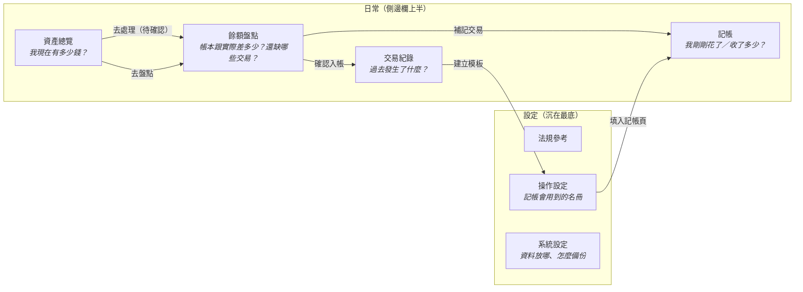
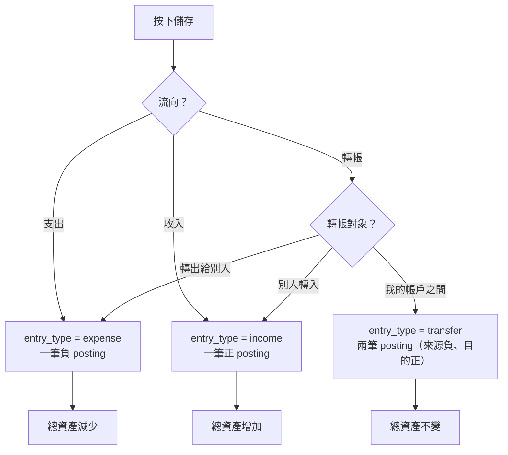
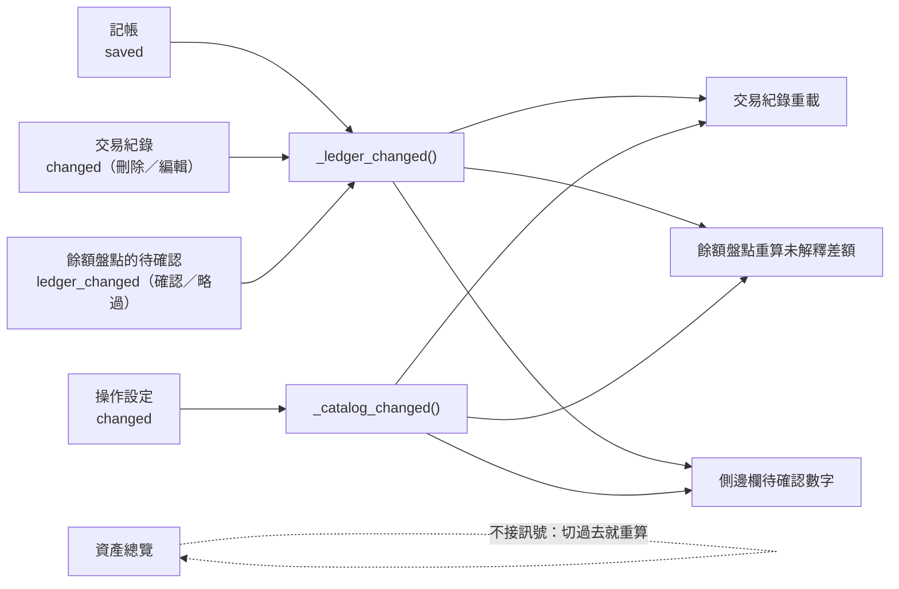

# UI Workflows

**本檔的權威範圍：** 側邊欄順序、每一頁回答什麼問題、各頁的操作流程。

> **側邊欄順序與頁面名稱的程式正本是 [`ui/navigation.py`](../../src/tagcor_ledger/ui/navigation.py)**
> 的 `DAILY_PAGES` / `SETTINGS_PAGES` / `LABELS`。下面的頁面地圖由
> `tests/unit/test_docs_drift.py` **逐字比對**，改了程式而沒改這裡會讓測試變紅。

---

## 頁面地圖

**這張表是這份文件最重要的部分。** 沒有它的時候，連作者自己都會忘記「待確認」是做什麼的
—— 那不是記性問題，是那一頁沒有講出自己是誰。

| 頁面 | 它回答什麼問題 | 什麼時候用 | 不在這裡做的事 |
|---|---|---|---|
| **資產總覽** | 我現在總共有多少錢，還有什麼事沒處理？ | 開啟程式的第一眼 | **不提供任何操作。** 只有兩顆把你送到能處理的地方的按鈕 |
| **記帳** | 我剛剛花了／收了多少？ | 每天，最常用的一頁 | 不處理定存到期 —— 那個在餘額盤點底下的待確認 |
| **交易紀錄** | 過去發生了什麼？ | 要查、要改、要刪除時 | 不能在這裡新增 —— 新增在記帳 |
| **餘額盤點** | 帳本跟實際數出來的錢差多少？還缺哪些交易？ | 想對一下的時候；側邊欄這一列有數字時（待確認） | **盤點不建立交易，待確認不會自己入帳。** 差額的處置是補記交易或確認草稿，不是叫程式生一筆調整；定存合約的帳戶與類別在這裡改不了（去「操作設定 → 定存」） |
| **法規參考** | 這件事的法規怎麼規定？ | 需要查條文時 | 不連網。內容是專案裡的靜態資料 |
| **操作設定** | 記帳時會用到的東西怎麼管？ | 要加帳戶、類別、項目、模板、定存時 | 不放危險操作 —— 備份、還原、重製在系統設定 |
| **系統設定** | 資料放哪裡、怎麼備份？ | 一年看兩次 | 不放日常偏好以外的東西 |



## 側邊欄

固定順序，由上到下：

**日常**（上半）

1. 資產總覽
2. 記帳
3. 交易紀錄
4. 餘額盤點

**設定**（沉在最底）

5. 法規參考
6. 操作設定
7. 系統設定

> **2026-10-05 之前「待確認」是第 3 頁**，現在是餘額盤點頁底下的一塊
> （[ADR-0016](../decisions/ADR-0016-inbox-under-balance-snapshots.md)）。日常頁的順序是
> 使用者定的：看狀況 → 記帳 → 查帳 → 對帳。

- **側邊欄裡沒有分組標題。** 「日常」「設定」只是程式裡的常數名稱（`DAILY_PAGES`、
  `SETTINGS_PAGES`），畫面上不顯示。分組靠**位置**表達：日常在上、設定貼底，中間是
  會隨視窗長高的留白，中間隔一條 `QFrame#separator`。
  **側邊欄裡的每一個字都可以點** —— `tests/ui/test_navigation.py` 的
  `test_every_sidebar_row_can_be_clicked` 守著。
- 這條路用「程度差異」試過兩次都失敗（第一版只是顏色淡一點，第二版縮小加字距），
  兩次使用者的反應都是「這是什麼？為什麼點不動？」。理由寫在
  [失敗紀錄](../lessons.md)與 `ui/navigation.py` 的模組說明。
- **待確認的數量畫在「餘額盤點」那一列的右側**（`navigation.PENDING_PAGE`），不寫進標籤文字
  （舊做法是把文字改成「待確認（2）」，標籤長度會隨數字跳動）。數字來自
  `controller.inbox_count()` —— 側邊欄與資產總覽走同一個來源，不會出現兩個不一樣的數字。
- 視窗寬度 < 1100 px 時側邊欄從 184 縮到 152。**不做圖示折疊模式** —— 專案沒有圖示集。
- **視窗寬度 < 720 px（`layout.NARROW_BREAKPOINT`）時沒有側邊欄**，換成頂端一顆
  「☰ 目前頁名」的選單按鈕：同樣的頁面、同樣的分組（中間一條分隔線），待確認有事時
  寫成「餘額盤點（3）」。「現在是哪一頁」的正本仍然是側邊欄，它只是藏起來。
- **啟動預設停在資產總覽**（`navigation.LANDING_PAGE`）。記帳是「我要做一件事」，
  總覽回答的是「我現在是什麼狀況」；真的要記帳，`Ctrl+N` 一鍵就到。

## 版面規則

**每一類頁面各自的最大寬度，內容置中。** 一個全域上限套全部是錯的：表單再寬只會讓
標籤與欄位隔半個螢幕，但交易紀錄有七欄，寬度是真的有用。

| 頁面 | 最大寬度 | 常數 |
|---|---|---|
| 記帳 | 880 | `ENTRY_WIDTH`（外距左右 40，`ENTRY_PAGE_MARGINS`） |
| 盤點與設定裡的表單區 | 720 | `FORM_WIDTH`（`form_panel()` 的預設） |
| 資產總覽 | 980 | `SUMMARY_WIDTH` |
| 其餘（有資料表的） | 1600 | `TABLE_WIDTH` |

- 行為是 `min(可用寬度, 上限)` 並置中。
- **欄位少的表格收到欄寬總和**（`fit_content`），不然表頭只畫到最後一欄就結束，
  右邊留下一大塊有框線卻沒有表頭的空白。
- **操作設定裡的表格連高度也收到列數**（`fit_rows`，上限 14 列），否則三列資料會變成
  一條又窄又高、幾乎全是空框線的長條。每個分頁最後都要有 `addStretch()`。
- **每一頁包在自己的捲動區裡**（`layout.scrollable()`），所以視窗可以縮到手機寬度
  （下限 `window_state.MINIMUM_WIDTH`×`MINIMUM_HEIGHT`＝360×480）：放不下的頁
  （交易紀錄、操作設定的表格）橫向捲動，**記帳頁不可以** —— 窄於 560 px 時標籤移到
  欄位上方、轉帳對象三顆按鈕改直排（`entry.WRAP_WIDTH`）。窄視窗的外距從 24 收到 12。
- 捲動區不改變「一般螢幕不該捲」這件事：`tests/ui/test_layout.py` 守住**每一頁**的
  最小尺寸裝得進 1024×880 扣掉側邊欄。
- **記帳頁的標籤靠右貼著欄位**（窄版面標籤在上方時靠左）。列距固定 16 px ——
  試過隨視窗高度伸縮，切到轉帳時列距重算、每個欄位都在跳，所以不做。
- **每次啟動都是預設大小（1280×760，螢幕較小時縮到可用範圍）、置中**，不記上次的
  大小與位置（2026-09-27 使用者指定）。舊版的 `config_dir/window.json` 不讀也不寫。

## 視覺主題

- 介面固定使用深色主題（**中性純灰，零色偏**），不提供主題切換。
- **彩色只留給金額與警示。** 主要操作是近白底深字（靠明度不靠色相）；刪除、
  重製、還原等高風險操作用紅色。色票正本是 `ui/colors.py`。
- UI 字體：`Microsoft JhengHei UI`、`Microsoft JhengHei`、`Noto Sans TC`、
  `Segoe UI Variable`、`Segoe UI`、sans-serif。**主字體必須是中文字型** ——
  理由見下面〈UI 樣式規範〉。
- 新增 UI 元件時，若用途不同需指定 objectName，避免全域 QSS 影響其他元件。
- **選取列靠底色 ＋ 上下兩條橫線，不是只靠底色。** 選取底 `SELECTED` 對一般列底
  `SURFACE` 的對比只有 1.34，而那已經是上限 —— 再亮一階，支出紅對選取列的對比就掉到
  4.5 以下。明度這個維度在深色主題裡本來就窄，所以第二個線索用**形狀**。
  框線會吃掉 `::item` 的內容高度（Qt 的 `::item` 是 content-box，而列高被
  `defaultSectionSize(34)` 釘死），所以 `padding` 要同步從 7px 收成 6px ——
  `test_resources.py` 有一條逐項對算。

## UI 樣式規範

**這一節是 UI 樣式的權威**（2026-09-13 從 `AGENTS.md` 搬過來；那一份只留會出事的幾條與指回這裡的指標）。
有測試守著的規則在條文裡點了測試名 —— 那些不是建議。

**色票的正本是 `ui/colors.py`。** QSS 裡不得出現那份清單以外的色碼，`test_resources.py` 會掃過去比對。要新增顏色就先去那邊宣告，並且**算過對比**再用。

- 固定深色主題（**中性純灰，零色偏**），由 `tagcor_ledger.ui.theme.apply_dark_theme(app)` 套用 `Fusion` style、字體、palette 與 `styles.qss`。palette 與 QSS 都從 `colors.py` 取值。
- **彩色只留給金額與警示。** 主要按鈕是近白底深字（靠明度，不靠色相），選取列是淺一階的灰，焦點框是中性亮灰。畫面上任何一抹紅或綠都應該是資訊。
- 金額：支出紅 `EXPENSE`、收入綠 `INCOME`、轉帳不上色。顏色**不是唯一線索** —— 一律同時有正負號與右對齊。
- **圖表也是灰階，沒有例外。** 資產占比圓環的色階是 `colors.CHART_SLICES`（六階，由淺到深），
  占比由圖例上的數字講，色階只負責讓人看出哪一片比較大。三條硬規則：
  1. **它刻意不在 `ALL_TOKENS` 裡。** 那個集合是 **QSS 的允許清單**，而圓環與圖例色塊
     是 `QPainter` 畫的、一個字都不經過樣式表。加進去等於在 QSS 那一側開六個沒人用的洞。
  2. **每一階對底色的對比 >= 3.0**（WCAG 1.4.11 圖形物件）。實算過 `#5C5C66` 只有 2.73、
     `#45454E` 只有 1.90 —— **梯度不能再往深處延伸**，而「再加一階就好」是最容易順手做的事。
  3. **片數少的時候要在整條梯度上平均取樣**（`slice_colors()`），不是拿前 N 個 ——
     拿前三階的話最大與第二大只差一個色階，實機上看起來就是兩片一樣的淺灰。
  `tests/unit/test_resources.py` 三條都守著。
- 所有「文字／底色」組合的 WCAG 對比 >= 4.5，而且要拿**選取列**（最亮的底）去算。
- 不要用過寬的全域 QSS selector 污染不同用途元件；共用元件若用途不同，需指定 objectName。
- 側邊欄外框用 `sidebarRail`（`QFrame`，右框線畫在這一層）、兩個導覽清單用 `sidebarNavigation`；備份清單用 `backupList`；內容堆疊用 `contentStack`；每一頁的置中容器用 `pageContent`；狀態訊息用 `statusLabel`（帶 `state` 屬性）；流向切換用 `segmentButton`；資產總覽的大數字用 `totalAmount`。
- **側邊欄裡不得有任何點不動的東西。** 分組不放標題，靠位置表達（日常在上、設定沉底，中間留白）。這條路用「程度差異」試過兩次都失敗，第三次是把標籤整個移除；理由見 `ui/navigation.py` 的模組說明與 `docs/lessons.md`。有測試守著。
- **側邊欄兩組清單的 current row 必須一直是有效的**，而且「現在是哪一頁」由 `Sidebar._current` 記，不從 widget 狀態反推。把 current row 設成 `-1`，`QAbstractItemView::focusInEvent` 就會自己把它設成第 0 列並發出 `currentRowChanged` —— 焦點一碰到側邊欄，畫面就換頁。**不要把 `currentRowChanged` 當成「使用者選了什麼」。**
- **導覽用 `PageId`，不得拿顯示文字當 key。** 頁面身分在 `ui/navigation.py` 的 `PageId`，顯示文字在 `LABELS`；改 `LABELS` 不影響任何查表。側邊欄順序的唯一正本是 `DAILY_PAGES` / `SETTINGS_PAGES`，改了要同步 `docs/architecture/ui-workflows.md`（`tests/unit/test_docs_drift.py` 會逐字比對）。
- **版面走 `widgets/layout.py` 的 `page_layout(self, width=...)`**，不要各頁自己 `QVBoxLayout(self)`。寬度上限：記帳 `ENTRY_WIDTH`、表單 `FORM_WIDTH`、摘要 `SUMMARY_WIDTH`、有資料表的 `TABLE_WIDTH`。
- **欄位少的表格用 `fit_content=True` 收寬**；操作設定裡的表格另外用 `fit_rows=SETTINGS_TABLE_ROWS` 收高度，而且該分頁最後要有 `addStretch()`，否則 layout 會把多餘高度平均塞進元件之間。
- **有自由文字欄（名稱、備註）的表要同時指定 `stretch_column`，讓那一欄讓路。** 收寬設的是 `setMaximumWidth`，那是**上限不是保證** —— 名稱一長，`ResizeToContents` 的欄寬總和就超過分頁能給的寬度，欄位照樣溢出、底下冒出橫向捲軸；而這些表是固定高度，捲軸會從那個高度裡扣掉自己的厚度，**最後一列被切掉**，看起來像資料沒載完。指定之後空間夠時 stretch 欄分到的剛好是自己的內容寬度（畫面不變），不夠時只有它被壓縮成 `…`。`setup_table` 另外關掉 `wordWrap` —— 列高釘死成單行，折行只會讓省略看起來像壞掉。
- **UI 用詞與資料表名稱可以不同**（例如使用者看到「項目」，schema 是 `categories` 的第二層）。已淘汰的 UI 用詞列在 `tests/unit/test_architecture.py` 的 `RETIRED_UI_WORDS`，該測試掃 `ui/` 與 `application/` 的字串常數（docstring 與註解不算）。**已移除的功能名稱也在那份名單上** —— 一顆通往不存在功能的按鈕比錯的用詞更糟。
- 主要操作按鈕用 `primaryButton`；刪除、重製、還原等高風險操作用 `dangerButton`。
- **有些字串照抄程式外面的正本，不得縮短。** `domain/deposits.py` 的
  `MATURITY_ACTION_NAMES` 四個名字逐字照郵局定期儲金存單（`REQ-0007` §列舉 是文件側的
  正本）—— 使用者在那個下拉選單前面做的事就是把實體單據上的打勾抄過來，
  文字不逐字相同他每次都要自己重新推導對應關係。縮短一個 UI 字串之前先問：
  **它在程式外面有沒有一個正本？**
- **表格不得在 QSS 設 `color` 或 `selection-color`。** 那會蓋掉 model 的 `ForegroundRole`，金額的紅綠會被壓成同一個白。顏色由 `widgets/table.py` 的 `amount_color` 決定。
- **勾選框的已勾選狀態要有勾號，不能只靠填色。** 實心白對空心黑的對比有 14:1，兩個狀態絕不會看成一樣 —— 但「**哪一個代表開**」仍然要靠慣例。五個勾選框裡有兩個守著不可逆的操作（`還原前先建立備份`、`重製前先建立備份`），那兩個不該要求使用者知道慣例。與下面兩條是同一個原則的三次套用：第二個線索要用**形狀**。
- **選取列靠底色 ＋ 上下橫線，不是只靠底色。** `SELECTED` 對一般列底 `SURFACE` 的對比只有 1.34，
  而那是上限 —— 再亮一階，支出紅對選取列的對比就掉到 4.5 以下（`test_resources.py` 會紅）。
  深色主題的明度空間本來就窄，第二個線索要用**形狀**。
  **加框線就一定要同步收 `padding`**：Qt 的 `::item` 是 content-box，而列高被
  `defaultSectionSize(34)` 釘死，直接加 2px 框線等於從文字的可用高度裡扣，中文會被切到。
  7px 配 0 框線 ＝ 6px 配 1px 框線，`test_selecting_a_row_does_not_squeeze_the_text` 逐項對算。
- **對所選項目動作的按鈕一律用 `bind_selection` 綁選取狀態。** 沒選取就停用，不要讓使用者按下去什麼都不發生。（注意停用會讓焦點跑掉 —— 焦點跑到哪裡都不該有副作用。）
- **一個錯誤碼只能代表一件事。** 寫入層丟的是 `raise ValueError("SOME_CODE")`（訊息就是碼），應用層用 `application/failures.py` 的 `failure()` 把它翻成中文：**認得出來的碼就用那個碼**，認不出來才退回呼叫端給的 `fallback_code`。碼的中文說法只寫在 `ERROR_MESSAGES` 一個地方，情境需要不同說法時用 `overrides=`。
- **`details["reason"]` 是廢除的 key，加回來 `tests/unit/test_failure_messages.py` 會紅。** 它曾經有 51 個出處，而 `result_message()` 會把它用括號接在畫面訊息後面 —— 於是英文碼與 SQLite 原文都被印給使用者看。預期外的原文放 `details["detail"]`，**那個 key 永遠不顯示**。
- **例外的訊息就是錯誤碼，不要寫英文散文。** `domain/money.py` 以前丟 `MoneyError("Amount must be greater than zero.")`，那句英文因此出現在全中文的畫面上 —— 而且金額打錯是最常見的操作失誤。UI 自己 `except` 的地方用 `ui/formatting.error_text()`，不要直接印 `str(exc)`。
- 分頁必須由 QSS 覆蓋 `QTabWidget/QTabBar` 的 selected、unselected、hover、disabled 狀態。
- **QSS 一碰 subcontrol，Fusion 就不再畫它自己的圖形。** 這條踩到兩次：
  - **不要覆寫 `QComboBox::drop-down`** —— 箭頭會消失，剩下一塊空白方格。那個很明顯是壞了，所以當場就發現。
  - **`QCheckBox::indicator` 已經覆寫了**（為了方框：Fusion 的外框色是 `palette.window().darker(140)` 推導的，在 `#0D0D0F` 上完全看不見），所以勾號要**自己給圖**，`styles.qss` 的 `:checked` 有一行 `image: url(...)`，路徑由 `theme.py` 的 `resolve_stylesheet()` 在載入時代換。這一次的症狀是一塊**看起來很像設計**的實心白方塊 —— 沒有人發現它壞了。
  - 要給圖只能給 **PNG，而且標準與 `@2x` 兩個尺寸都要**。SVG 需要 Qt SVG image plugin（PySide6 的選配元件，本機的 conda env 就沒有），QSS 的 `url()` 也不吃 `data:` URI —— 兩條都實測過，失敗的樣子都是「那一格靜靜地不畫圖」。圖檔由 `tools/icons/make_check_icon.py` 產生，不要用繪圖軟體改。
- **主字體必須是中文字型**（`Microsoft JhengHei UI` 排第一），12pt、Medium 字重。理由是 `Segoe UI Variable` 沒有中文字形，中文全靠 fallback，而**字重套不到 fallback 字型上** —— 對它設 Medium 只有數字變粗，中文一點都沒變。字體不打包，順序是 `Microsoft JhengHei UI`、`Microsoft JhengHei`、`Noto Sans TC`、`Segoe UI Variable`、`Segoe UI`、sans-serif。
- **日期欄位一律用 `date_field()`，不要用 `QDateTimeEdit`。** 介面只問到「哪一天」；時分秒由 `iso_from_date()` 補上（新建補現在、編輯沿用原值），資料庫存的仍然是完整時間戳。顯示一律用 `display_date()`，**不要把補出來的時分印出來** —— 那不是使用者輸入的東西。
- UI 變更至少跑 `tests/ui` smoke；樣式資源變更需同步更新 `tests/unit/test_resources.py`。
- **`apply_dark_theme()` 要在任何 widget 建出來之前套用**（`MainWindow.__init__` 的第一件事），而且**一個 process 只套一次**（有標記擋著）。`setFont`／`setPalette`／`setStyleSheet` 是 application 層級的操作，Qt 要傳播給當下活著的每一個 widget —— 重複套用的成本隨 widget 數量成長，而且比線性還快。正式執行只開一個視窗所以看不出來；**測試裡會讓整包從幾分鐘變成 32 分鐘**。它換掉整個 application 的字體，而表格在建構當下就會量自己該多寬 —— 順序反了，量到的是預設字體下的寬度，之後就再也不會重算。**UI 測試的 fixture 不要順手多做一次 `refresh()`**：那會把「第一次就要對」這個條件洗掉，而使用者看到的永遠是第一次。
- **改配色或改樣式之後要真的看一眼。** `window.grab().save(...)` 可以在不開視窗的情況下把畫面存成 PNG（用 `QT_QPA_PLATFORM=windows` 才有中文字型）。純看 QSS 看不出「顏色被蓋掉」這種問題。**抓最上層視窗**，用 `QTimer.singleShot` 在事件迴圈裡觸發，grab 之前先 `repaint()` —— 單獨 grab 巢狀子 widget 會憑空生出不存在的 bug（`docs/lessons.md` 2026-08-20）。
- **UI 測試量 geometry，不量設定值，也不用 `isVisible()` 過濾。** `QStackedWidget` 底下的頁在 offscreen 平台上永遠回報 `isVisible() == False`，用它當過濾條件會讓整條守門靜默跳過。斷行要比 `label.width() >= fontMetrics().horizontalAdvance(text)`，高度要比 `header + 列數 × 列高`。**每一個帶 `continue` 的檢查迴圈都要有陽性對照**（`assert checked >= N`）。

## 資產總覽

由上到下：總資產大數字 →（各帳戶餘額 ＋ 占比圓環）→ 定存 → 待辦。

- **總資產只加總「使用中」帳戶。** 封存的意思是不出現在選單，**不是錢消失了** ——
  封存帳戶若還有餘額，另外列一行講清楚，否則使用者拿這個數字去對存摺會對不起來。
- **帳戶表右邊是占比圓環**，兩者並排：表格回答「每個帳戶有多少」，圓環回答「比重
  長什麼樣」。同一份資料的兩種讀法，所以不上下排。表格照使用者的自訂順序，圓環照
  金額由大到小 —— 圓環有自己的圖例（色塊｜名稱｜金額｜占比），不必與表格對得起來。
  - **灰階，不是彩色。** 「彩色只留給金額與警示」這條規則沒有為它破例；占比由圖例
    上的數字講，色階只負責讓人看出哪一片比較大。色票在 `ui/colors.py` 的
    `CHART_SLICES`，**刻意不在 `ALL_TOKENS` 裡**（那是 QSS 的允許清單，圓環是
    `QPainter` 畫的）。每一階對底色的對比 >= 3.0，由 `test_resources.py` 守著。
  - **片數少的時候色階要拉開。** 三片拿頭、中、尾而不是前三階 —— 拿前三階的話最大
    與第二大只差一個色階，實機上看起來就是兩片一樣的淺灰。
  - **最多六片**，超過就把最小的那些併成「其他（N 個帳戶）」。上限等於色階數：
    再多一片就沒有分得出來的灰可以給它。
  - **餘額為負的帳戶不畫。** 圓餅對負數沒有定義，取絕對值畫則會讓一個把錢吃掉的
    帳戶看起來像一份資產。那些帳戶另外用一行字交代，做法與封存帳戶那一行相同：
    不算進去，但也不默默不提。此時占比的**分母是正餘額合計、不是總資產**，
    圖例底下會把那個數字寫出來 —— 否則使用者拿百分比去乘總資產會對不起來。
  - **一片都畫不出來就整段收起來**（全新的帳本、或所有帳戶都是 0）。
    一個空的圓框看起來像壞掉或還沒載入。
- 沒有定存合約時，「定存」那一整段不顯示。空的區塊會讓人以為是壞掉或還沒載入。
- 待辦有兩種：待確認筆數（＋「去處理」）、最近一次盤點的**未解釋差額**（＋「去盤點」）。
  兩顆都通往餘額盤點頁；「去處理」另外捲到底下的待確認那一塊（`MainWindow.show_pending()`）。
  差額為 0 或還沒盤點過時整列不顯示 —— **「差額 0」不是待辦事項。**
  - **「今天還沒盤點」那一則拿掉了**，理由在
    [ADR-0014](../decisions/ADR-0014-drop-daily-snapshot-reminder.md)：
    它依日曆觸發，而餘額盤點是一個不定期的動作。
    留下來的兩則**觸發條件都是外部事實**（定存到期、帳對不上），不是日期。
  - 「去盤點」那顆按鈕跟著搬到差額那一列 —— 所以**沒有差額時，
    這一頁沒有通往餘額盤點頁的按鈕**。那是刻意的：沒有事情要做的時候，
    不該有一顆叫你去做事的按鈕。
- **切到這一頁就重算**，不靠其他頁發訊號通知。它讀的東西橫跨帳戶、定存與
  盤點，要在每個 `_..._changed` 各記一筆的話遲早漏掉一項，而漏掉的症狀是總資產停在
  舊數字 —— 看起來像算錯帳。

## 記帳

支出／收入流程：

```text
流向 → 帳戶 → 日期 → 類別 → 項目 → 金額 → 備註
```

轉帳流程 —— **先選對象，欄位跟著換**：

```text
流向 → 轉帳對象 → 帳戶 → 轉入帳戶（僅我的帳戶之間）→ 日期 →（類別 → 項目）→ 金額 → 備註
```

| 轉帳對象 | 「帳戶」叫什麼 | 還要填 | 存成 |
|---|---|---|---|
| 我的帳戶之間 | 轉出帳戶 | 轉入帳戶 | `transfer` |
| 別人轉入 | 收款帳戶 | 類別／項目 | **收入** |
| 轉出給別人 | 付款帳戶 | 類別／項目 | **支出** |

- **流向用三顆分段按鈕，不是下拉選單。** 選項永遠只有三個。
  轉帳對象也是分段按鈕，只在流向＝轉帳時出現。
- **金額是主角，但它排在最後面，而且只靠字重**：粗體 ＋ `Ctrl+N` 直接聚焦到它，
  **字級與高度與其他欄位一致**。欄位由上到下照使用者實際填寫的順序：先決定這筆錢的
  身分（帳戶、哪一天、類別、項目），最後才打唯一每次都要動手的那一格。
  （強調的手段與位置是綁在一起的：放大三個維度是它還排在第三列時訂的，
  搬到中間之後同樣的對比就變成「凸一塊」。）
- 用不到的欄位**整列**收起來（含標籤）。「帳戶」那一列的標籤隨對象改字 ——
  同一個下拉在三種情境下問的是不同的問題。
- **對外轉帳存成收入／支出，不是 `transfer`。** 判準是總資產有沒有變；
  理由與被否決的替代方案見 [ADR-0010](../decisions/ADR-0010-external-transfers.md)。
- 內部轉帳的**轉入帳戶預設會避開來源帳戶** —— 兩個下拉停在同一個帳戶時按儲存必定失敗。
- **切流向時，留著的欄位一格都不動**：支出、收入、轉帳・我的帳戶之間都是七列，
  金額以下的位置完全相同；欄位左緣四種情形都相同。三個條件缺一不可 —— 列距固定、
  標籤欄固定成所有可能標籤裡最寬的（`_pin_label_column()`）、分段按鈕與下拉一樣高
  （QSS 的 `segmentButton`）。`test_switching_flow_never_moves_the_fields_that_stay` 守著。
- **幣別在金額框內右緣當背景提示**（灰色「TWD」，`forms.add_suffix_hint()`），
  標籤只寫「金額」—— 寫在標籤上會把整欄標籤撐寬。
- 成功與失敗共用一個訊息位置，**在「清空」的右邊**，顏色不同（綠／紅）。
  不是獨立一列：那樣沒訊息也佔一列，備註與按鈕之間空一大塊。**「交易已儲存。」三秒後自己消失**
  （`entry.SAVED_MESSAGE_MS`）—— 留著不動的話，填第二筆時畫面上還寫著上一筆存了，
  分不出眼前這筆存了沒。失敗訊息不會被清掉，那是要讀完的。
- 「儲存交易」旁邊有一顆**「清空」**，與 `Esc` 是同一件事：日期回今天、金額與備註清空，
  **流向／帳戶／類別留著** —— 連記幾筆同類的帳時那幾格本來就該留著。
- **儲存成功後只清金額與備註，日期留著。** 補記前幾天的帳時同一天常連記好幾筆，
  以前每存一筆日期就跳回今天，下一筆忘了改就記錯天。要回今天按「清空」；
  模板「填入記帳頁」仍然把日期設成今天。



> **判準是總資產有沒有變。** 這張圖是 [ADR-0010](../decisions/ADR-0010-external-transfers.md)
> 的一句話版本；為什麼不新增 `entry_type` 寫在那裡。

## 頁面之間怎麼連動

**所有跨頁規則都寫在 `ui/main_window.py`。** 每一頁只管自己，做完事情就發訊號。



**三個會改動帳務的來源接同一個方法，不是三個「差不多」的方法。** 那份清單就是
下一個會漏的地方 —— 2026-08-21 之前交易紀錄根本沒有對外發訊號，於是刪掉一筆帳
之後餘額盤點的差額停在舊值（見 [失敗紀錄](../lessons.md)）。

**資產總覽刻意不在這條線上**，它走「切過去就重算」；理由見 `overview.py` 的模組說明。

**操作設定那條線要明講三件事**（`_catalog_changed()`）：交易紀錄重載（類別改名、更改所屬類別
會改變交易顯示的名字，定存的中途解約會建立交易）、盤點頁重查（含待確認清單）、待確認數字重算
（定存頁的「產生」會長出新的草稿）。2026-10-05 之前前後兩件是**順帶**發生的 —— 待確認頁重整時
一律發 `changed`，連鎖到 `_ledger_changed()`。那條連鎖拿掉時差一點就跟著拿掉了，
`test_a_catalog_change_reloads_the_transaction_list` 現在盯著。

## 交易紀錄

- 支援文字、日期區間、帳戶、類別與狀態篩選；上一頁／下一頁用 keyset pagination。
- 支出與收入可直接編輯。
- **轉帳用替換流程**：新轉帳建立成功後，舊轉帳在同一個資料庫 transaction 刪除。
- 表格底下三顆按鈕，由左到右：**編輯、刪除、建立模板**（`tests/ui/test_transactions_page.py`
  量 x 座標守著）。三顆都要先選一列；「刪除」另外要那一列是有效的 —— 對已刪除的交易它是停用的，
  不是按了沒反應。
- **「編輯」對轉帳其實是替換**：對話框標題「替換轉帳」、儲存鈕「建立新轉帳並刪除原交易」把差別講在
  按下去之後，按鈕本身不再寫「編輯／替換」。
- **「刪除」是 `void`，紀錄留著**：那一列的狀態變成「已刪除」，篩選「已刪除」看得到，不可復原。
  按鈕與確認框都寫「刪除」（2026-09-20 起；之前叫「作廢」），確認框會講紀錄會保留。
- **「建立模板」不在這一頁做事。** 它把所選交易送到「操作設定 → 模板」，切到那個分頁並開一張
  **已經填好**的新增視窗（流向、帳戶／轉入帳戶、類別／項目、金額、備註），模板名稱留白讓使用者取；
  使用者自己按儲存，存完停在模板分頁。這顆按鈕 2026-09-20 之前叫「複製到記帳」——
  把同一筆帶回記帳頁再存一次；那件事模板的「填入記帳頁」本來就會做，而且做得更好。

## 餘額盤點

**兩件事：帳本跟實際數出來的錢差多少，以及還缺哪些交易。** 由上到下：

1. 表單只負責**新增**：帳戶、盤點日期、實際金額、備註（「帳戶」同時是底下清單的篩選）。
2. **一排**「新增盤點」「編輯」「刪除」（使用者 2026-10-05 指定排在同一排）。
   「編輯」「刪除」對所選盤點動作，沒選就停用。沒有「重新整理」—— 換帳戶本來就會重查，
   跨頁的改動由 `main_window` 通知。「匯出盤點 CSV」2026-10-05 搬到系統設定。
3. 最近一次盤點的摘要（實際、預期、未解釋差額），然後「盤點紀錄」表：
   盤點日期／實際金額／預期金額／未解釋差額／備註。**沒有帳戶與狀態兩欄** —— 每列同值。
   一次列 50 筆，滿了才出現「載入更多」（以前寫死 50 筆、沒有下一頁，一個帳戶每月盤點一次，
   四年多之後最舊的就看不到了）。換帳戶從第一頁重新開始。
4. **「補記與待確認」**（下一節）。

- **「編輯」開對話框**（帳戶／盤點日期／實際金額／備註），按儲存才寫入，失敗留在視窗裡說；
  時分秒沿用原值。點表格某一列**不會**把值倒進上方表單（2026-09-20 之前會，正在打的新盤點
  就被蓋掉，而那顆「更新所選盤點」一按就寫入）。
- **「刪除」真的移除那一筆**（2026-10-05 起，[ADR-0015](../decisions/ADR-0015-delete-balance-snapshots-for-real.md)；
  之前是 `void`、紀錄留在「已刪除」篩選裡）。確認框念出是哪一天那次盤點、講「刪掉之後就找不回來」，
  以及後面那一次盤點的差額會改拿再前一次重算。「列表狀態」下拉跟著拿掉了。
- **沒有「差額期間內的交易」那張表**（2026-09-20 拿掉）。它佔掉半頁，而要查交易本來就有
  交易紀錄頁，帳戶與日期區間都篩得到；底下那條只有它在用的查詢也一起移除了。
- **盤點不建立交易。** 差額不為零時的處置是補記交易或確認待確認的草稿，不是叫程式生一筆調整。

### 補記與待確認

未解釋差額不為零，通常是兩種情形，**這一塊就是它們的處置**：

| 情形 | 處置 |
|---|---|
| 有交易漏記了（使用者自己知道） | **「補記交易」**：切到記帳頁，**帳戶先選好**這一頁正在看的那一個，其他欄位不動 |
| 定存的利息、到期本息還沒確認入帳（程式算得出來） | **待確認清單**：確認入帳之後差額**在同一頁當場重算** |

**待確認以前是側邊欄獨立的一頁**，2026-10-05 併進這裡，理由在
[ADR-0016](../decisions/ADR-0016-inbox-under-balance-snapshots.md)。使用者原本以為待確認是盤點
造成的 —— 不是，待確認只由定存產生；但他感覺到的那個關聯是真的。

待確認的規則（`ui/pages/inbox.py` 的 `InboxSection`）：

- **一張表、兩顆按鈕。** 欄位：到期日／定存合約／事件／建議金額（TWD）。
- **唯一的來源是定存**（到期、領息、存入）。v0.23.0 之前定期收支也餵這裡，所以還有
  一欄「來源」與一顆「全部確認」；那個功能移除之後兩者都是「每一列印同一個字」
  （[ADR-0011](../decisions/ADR-0011-drop-recurring-schedules.md)）。
- **列出所有帳戶的待確認**，不跟著上方的帳戶篩 —— 側邊欄的數字是總數，清單只列一部分的話
  會出現「徽章說 2、畫面上 0」。
- **名稱不改。** 「待確認」問的是「有哪些草稿等我確認」，今天剛好只由定存供應 ——
  改成「定存到期」等於把它的身分綁在目前唯一的來源上。
- **確認入帳只問兩件事：入帳日期與實際入帳金額。** 金額以存摺為準（建議值只是試算），
  日期預設**事件的到期日**、銀行晚一兩天入帳時改得掉。**不開一張可以改帳戶與
  類別的表單** —— 那些是合約當初就決定好的，要改去「操作設定 → 定存」。
  日期欄是 v0.24.0 才有的：在那之前交易日期是「按下確認那一天」，而到期項目提前
  七天出現，照著提示馬上確認會讓交易早七天。
- **「金額以存摺為準」寫在表格上方一次，不是每一列一遍。**
- **這裡沒有「產生」按鈕。** 啟動時本來就會產生一次；程式開著的時候剛建了合約，
  用「操作設定 → 定存 → 產生到期與領息草稿」。一顆平常按了不會有反應的按鈕
  比沒有按鈕更糟。
- **「略過」只對領息與存入有效，到期會被擋下來**並說出替代作法（確認、金額填 0，
  或去定存頁結束合約／中途解約）。略過掉的事件不會再生出來，那一期會永遠停在
  「存續中」。
- **空的時候整組操作收起來，換成一行說明**：定存到期與每月領息會在這裡產生草稿，
  確認之後才會變成交易，程式不會自己記帳；要新增定存合約去「操作設定 → 定存」。
- **重查不發訊號。** `InboxSection.refresh()` 不發 `changed`，只有確認入帳／略過成功才發 ——
  盤點頁收到它會重整自己，而盤點頁重整會呼叫 `refresh()`：發了就是無窮遞迴（實測堆疊溢位）。

## 操作設定

四個分頁，**順序本身就是分組**：前三個是記帳會用到的名冊，最後一個是會自己到期的東西。

| 分頁 | 內容 |
|---|---|
| **帳戶** | 帳戶／目前餘額／狀態。新增、重新命名、封存、恢復、刪除未使用，「排序設定」設排序方式與自訂順序 |
| **類別與項目** | **左右並排兩張表**（2026-10-05 起）。左邊**類別**：類別／項目數／狀態，**每一個類別都有自己的一列，不管它有沒有子項目**。右邊**項目**：所屬類別／項目／狀態。**點左邊一個類別，右邊的「所屬類別」就切到它**、只列它底下的項目；右邊的下拉選「全部」看全部（單向，右邊不改左邊的選取）。兩邊各自有搜尋、狀態篩選與「排序設定」（項目那邊的視窗**兩欄：左邊排類別、右邊排它底下的項目**）；按鈕各分兩排：新增、重新命名（、更改所屬類別）／封存／恢復、刪除未使用、排序設定。「新增項目」的所屬類別預設停在目前篩選的那一個。**「更改所屬類別」**把所選項目掛到別的類別底下：下拉開在它現在的類別上、表單底下提醒**已經記過的交易與模板會一起改到新類別**（交易記的是項目）；目標底下已有同名的會被擋下來，只有一個類別時直接說沒地方可搬 |
| **模板** | 模板名稱／類型／帳戶／類別／金額／備註／狀態。**「填入記帳頁」只預填，不直接入帳**。新增、編輯、封存、恢復、刪除，「排序設定」設排序方式與自訂順序。也可以從交易紀錄的「建立模板」帶一筆交易進來 —— 開的是同一張新增視窗，欄位先填好、名稱自己取 |
| **定存** | 合約清單含**首次起存日**（存單上那一天）。新增、修改、**結束合約**、刪除、「產生到期與領息草稿」，以及每一期的「修改所選期（補利率用）」與**中途解約**。到期與領息只產生待確認 |

- **「類別」與「項目」在同一個分頁，但仍是兩張表**（`ui/pages/category_items.py`）。
  2026-10-05 使用者要求合併（「兩者性質相似，空間也夠同時顯示」）；v0.14.0 拆開的理由沒有變 ——
  類別十來個、很少動；項目幾十個、每個月都在加；**一張平的表兩邊都做不好**，舊版就是這樣漏掉
  「有子項目的類別沒有自己的列」，導致類別改不了名。所以並排的是兩張完整的表，不是併成一張。
  **不做「窄的時候上下排」**：分頁容器的最小寬度是所有分頁裡最大的那一個（定存約 790 px），
  這一頁拿到的寬度永遠放得下兩欄（約 700 px）；比那更窄的視窗，操作設定本來就是橫向捲動。
- 刪除只適用未被引用的設定項；被歷史資料引用時顯示繁中錯誤並建議封存。
  **封存不是刪除的前置條件** —— 兩者是兩條平行的出路，判準只有「有沒有被引用過」，
  使用中的帳戶只要沒被用過一樣刪得掉。各分頁的界線：

  | 分頁 | 刪得掉的條件 |
  |---|---|
  | 帳戶 | 非預設帳戶，且未被 posting／盤點／模板引用 |
  | 類別 | 沒有子項目，且未被引用 |
  | 項目 | 未被引用 |
  | **模板** | **永遠刪得掉** —— schema 裡沒有任何一張表指向 `transaction_templates`。套用模板產生的是一筆獨立交易，它不記得自己從哪個模板來 |
  | 定存 | 合約未產生過事件（**已入帳過的請改用「結束合約」**）|

- **定存頁有三顆容易搞混的按鈕，界線是「動不動到錢」：**

  | | 動到錢嗎 | 什麼時候用 |
  |---|---|---|
  | **結束合約** | 不 | 已經沒有存續中的期了（到期結清過），只是還掛在清單上。**還有存續中的期時會被擋下來** |
  | **中途解約** | 會 | 還在存續中就要提前解約。本金與利息都由使用者填，程式不試算違約息 |
  | **刪除所選合約** | 不 | **記錯了**。只有從未入帳過的才刪得掉 |

  結束的合約預設收起來，勾「顯示已結束的合約」看得到 —— **看不見但還在**是這個
  專案吃過虧的形狀（v0.22.0 的封存模板擋住帳戶刪除），所以那個核取方塊跟按鈕一起加。
  中途解約是定存頁**唯一**會產生交易的動作：到期一律走待確認，但提前解約沒有到期
  事件可以確認。
- **新增定存合約時填的是「首次起存日」—— 存單上印的那一天。** 使用者手上的存單印的
  是最初那一期，而勾了「無限次數自動轉期續存」的話郵局早就滾過好幾輪；程式負責算出
  該建立哪一期並**當場說出來**：

  > 存單上那一期在 2025/02/15 就到期了，而它無限次數自動轉期續存。
  > 目前存續中的是第 3 期：2025/11/15 – 2026/11/15 —— 建立的就是這一期。
  > 中間幾期不會補紀錄：當時的牌告利率與實際領到的利息都不在帳本裡。

  **那一行永遠都在**，不是只有填錯時才出現 —— 它回答的是「按下建立會發生什麼」。
  不自動轉存的則說「這份定存已經結束」（它沒有下一期可以滾過去）。
  本息續存還會多一句「本金請填目前存摺上的金額」，因為那個數字程式算不出來。
  見 [ADR-0012](../decisions/ADR-0012-deposit-events-start-at-record-date.md) 的「第二次修正」。
- **修改合約時「首次起存日」看得到但改不了。** 它是使用者對得回存單的那個數字，
  藏起來等於把那份對照弄丟；但改它會讓期序與實際滾過的輪數對不上。
- **「封存」在四個名冊分頁都是可逆的。** 模板在 v0.22.0 之前不是：清單只列使用中的，
  也沒有恢復 —— 封存等於讓那一列從畫面上永遠消失。而它還在資料庫裡**擋著它引用的
  帳戶與類別被刪除**，於是使用者會看到「這個帳戶已經有交易紀錄」而那個帳戶一筆交易
  也沒有。模板頁現在列出全部並帶「狀態」欄。
- **「類別」與「項目」的篩選與排序全部在 SQL 裡做**（`CategoryTreeFilter`），
  不是撈回來再用 Python 濾。排序也不用 `setSortingEnabled(True)` —— 那會讓
  `QTableView` 自己在 Python 裡排。表頭只負責「可點 ＋ 顯示箭頭」，真正的排序是
  把 `sort_key` 送回 SQL 再查一次，而 `sort_key` 只能是白名單裡的值。
- **排序只有一個入口：「排序設定」視窗。** 四頁（帳戶／類別／項目／模板）都有那顆按鈕。
  視窗左邊是**排序方式**（最多三層，每層一個欄位與升／降），右邊是**自訂順序**的拖曳區。
  - **點表頭排序已經拿掉了**（v0.19.0）。兩種入口並存時，點表頭會把使用者設好的多層
    規格整個換成單層，而畫面上沒有任何東西說明剛才設的為什麼不見了。
    `setSectionsClickable(False)` 寫在 `setup_table()` 裡 —— Qt 的預設是可點，
    而可點的表頭看起來就像可以排序。
  - **排序方式會記住**（存在 `settings` 這張 key/value 表，一頁一個 key）。
    每一頁有自己的預設：類別／帳戶／模板是「自訂順序」，項目是
    「所屬類別（自訂）→ 項目（自訂）」。**不能用空規格代表預設** —— 空的填進視窗
    會退成「下拉裡的第一個」，項目那頁就會掉成只剩一層。
  - **排序方式只影響那一頁。** 記帳頁的下拉與資產總覽一律照自訂順序 ——
    它們沒有排序 UI，不該跟著某一頁的偏好變。
  - **「自訂順序」在項目那頁是兩個欄位**：`sort_order` 的意義只在同一組之內，
    項目跨類別比自己的會互相穿插。
  - **排序方式沒用到自訂順序時，視窗會明講「拖曳的結果不會顯示在清單上」**（順序仍
    然存得下去）。不講的話，使用者拖了半天按確定卻沒變，看起來像壞掉。
  - **為什麼不放在主表格上**：v0.17.0 曾經在表格上放「上移／下移」，代價是**依欄位
    排序時必須停用它們** —— 畫面上那一列的鄰居不是儲存順序裡的鄰居，「上移」沒有
    可以解釋的結果。使用者點一次表頭就看到按鈕灰掉，而原因看不出來。
    搬進視窗之後衝突消失：**那個視窗永遠顯示自訂順序**，主表格愛怎麼排就怎麼排。
  - **視窗裡可以拖曳**，因為那是 `QListWidget` ＋ `InternalMove`（可寫入的 model）。
    主表格不行 —— 它是唯讀 model ＋ 在 SQL 裡排序，那是 `AGENTS.md` 的硬規則。
  - 同時提供**上移／下移按鈕**：只有拖曳的話，鍵盤操作沒有路可走。
  - **按「確定」才寫入**，取消要真的什麼都沒發生。
  - **封存的也列出來並標「已封存」** —— 藏起來的話它的順序值會停在舊的，
    日後恢復就出現在莫名其妙的位置。
  - **項目的視窗是兩欄**：左邊排類別、右邊排所選類別底下的項目。`sort_order` 的意義
    只在同一組之內，項目跨類別比它沒有意義（每組都是 10、20、30，會互相穿插），
    所以一份平的清單表達不了它。
  - **同一份順序也用在記帳頁的下拉** —— 名冊排好了但下拉沒跟著，等於沒排。
    帳戶的順序另外也決定資產總覽的列法。
- **狀態預設是「全部」。** 名冊分頁是管理用的，看不到封存的東西就沒辦法恢復它。
- **新增與重新命名都是一張表單、按一次確定。** 以前是兩個連續的 `QInputDialog`
  （先問名稱、再問期初餘額／先選類別、再打項目名），取消第二個會把第一個輸入的
  東西靜靜丟掉。

## 系統設定

- **一般設定**：預設帳戶、預設流向、每頁筆數。
- **資料路徑**：記帳資料路徑與備份路徑，提供切換既有資料與搬移目前資料；
  也顯示目前資料庫的完整路徑（唯讀，可選取複製）。
- **備份與還原**：建立備份、驗證、還原、**刪除**、選擇外部備份資料夾、匯出交易 CSV、
  **匯出盤點 CSV**（2026-10-05 從餘額盤點頁搬來 —— 匯出是「把資料帶出程式」的事，跟交易的放一起）、
  匯出診斷資訊。驗證／還原／刪除三顆都綁選取狀態，沒選就停用。
  **刪除不檢查備份有沒有效** —— 壞掉的那一份正是最需要清掉的。確認框會念出這一份
  是什麼，以及刪掉之後還剩幾份可用的備份；剩零份時明講，但**不擋**。
  只肯刪備份資料夾底下的東西，外部資料夾的備份請自己在檔案總管處理。
  清單一列是**時間｜狀態｜資料夾名**，完整路徑放 tooltip 與刪除確認框 ——
  上百字元的絕對路徑放進列裡會撐出橫向捲軸，而每一列前面那一大段還完全相同。
- **重製**：重製目前記帳資料，**不刪除備份資料夾**。

備份只由使用者手動按鈕觸發。還原／重製前保護備份必須勾選才執行。

## 狀態列

**只放暫時訊息。** 資料庫路徑曾經常駐在這裡吃掉一整行，而那是一年看兩次的東西 ——
現在住在「系統設定 → 資料路徑」。提醒也從這裡搬到資產總覽：一則 10 秒就消失的
訊息，去泡杯茶回來就看不到了，等於沒有提醒。

> 那時搬過去的是「今天還沒盤點」，而它**後來被整個拿掉了**
> （[ADR-0014](../decisions/ADR-0014-drop-daily-snapshot-reminder.md)）——
> 換位置解決的是「看不到」，解決不了「它說的事情不需要處理」。
> **兩件事都要對，那則提醒才有價值。**
